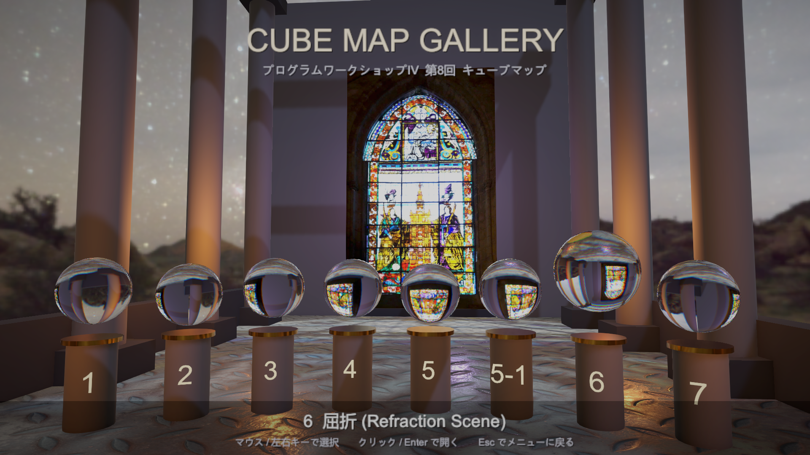
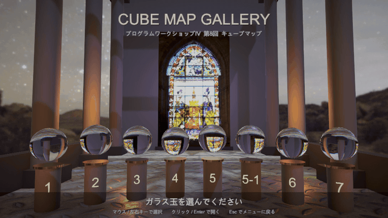
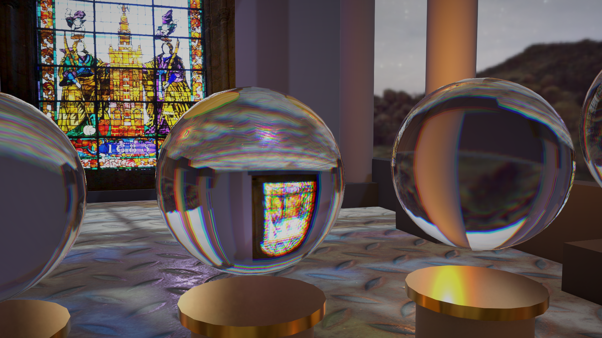

# はじめに
プログラムワークショップⅣの管理用です

# 結果画像

- 工夫した点：講義で作ったシェーダーを組み合わせて、ガラス玉がメニュー項目になるメインメニュー「8 Cathedral Menu Scene」を作った
  - **ガラス玉メインメニュー**：ガラス玉にマウスを重ねる（または左右キー）と、その玉だけ屈折率と色分散がなめらかに上がって浮き上がる。クリック（または Enter）で講義の各シーン（1〜7）を開き、Esc でメニューに戻れる。屈折率などは「スクリプトからシェーダパラメータを操作」の応用で、`MaterialPropertyBlock` を使って玉ごとに渡している
  - **色分散（プリズム効果）**：屈折方向を求める部分をサブグラフ（Refract Direction Shader Sub Graph）にまとめ、R・G・B で屈折率を少しずつずらして 3 回呼び出すことで、ガラスの縁に虹色のにじみが出るようにした（Refract Dispersion Shader Graph）。色分散を 0 にすると講義の屈折シェーダーと同じ結果になる
  - **大聖堂の環境**：柱が並ぶ星空の下の大聖堂を作り、奥のステンドグラスの光を「投影」のシェーダーで床に落として揺らしている。リフレクションプローブでベイクしたキューブマップをガラス玉のシェーダーに渡しているので、ガラス玉にはステンドグラスや柱が上下逆さまに屈折して映る。ブルームなどのポストプロセスも加えた

- 「7 My Best Scene」では、夜空のキューブマップを背景にして、屈折率を 1.05 / 1.2 / 1.33 / 1.5 と変えたガラス玉を4つ並べ、屈折の見え方の違いを比べられるようにした。両端には環境を映すクロムと金の金属球を置き、床には PBR テクスチャの金属板、奥にステンドグラスを配置した

# 進め方

- 本リポジトリをforkしてください
- fork先のリポジトリを更新してください
- Unityのプロジェクトをsrc内で進めてください
- 結果を画面キャプチャして、画像としてリポジトリに追加して、上記のリンクから見られるようにしてください
- 完成したら本リポジトリのmainブランチにpull requestを投げてください
